  

  

---

## 🧑‍💻 `cat about.txt`

  

I'm a cybersecurity professional with hands-on, real-world penetration testing experience. I run end-to-end engagements, from recon and exploitation through to reporting and remediation guidance tailored to each client's infrastructure, using both manual techniques and automated tooling. Along the way I've uncovered many critical vulnerabilities across web, mobile, API and cloud targets.

---

## 🛡️ Certifications

<table align="center">
  <tr>
    <td align="center" width="200">
       
      <b>Certified Active Directory Pentesting Expert</b> 
      HackTheBox
    </td>
    <td align="center" width="200">
       
      <b>Certified Penetration Testing Specialist</b> 
      HackTheBox
    </td>
    <td align="center" width="200">
       
      <b>Certified Red Team Operator</b> 
      Zero-Point Security
    </td>
  </tr>
</table>

---

## ⚔️ Arsenal

<b>🎯 Offensive Domains</b>

 

  
  
  
  
  
  

<b>🧰 Tooling</b>

 

  
  
  
  
  
  
  
  
  

<b>💻 Languages & DevSecOps</b>

 

  
  
  
  
  
  
  
  
  

---

## 🔭 What I'm Up To

- 🏴‍☠️ **CTFs & Labs** — always in the virtual trenches. Walkthroughs live in my [CTF repo](https://github.com/Moghees244/CTF).
- 📒 **Notes** — my pentesting & red team knowledge base: [moghees-ahmad.gitbook.io/notes](https://moghees-ahmad.gitbook.io/notes)
- 🧪 **Research** — building tooling, deliberately vulnerable apps, and poking at whatever looks breakable.
- 🎤 **Teaching** — running cybersecurity sessions for students.

---

## 📊 GitHub Stats

  
  

  

---

## 🤝 Connect With Me

  
  
  
  
  

  

